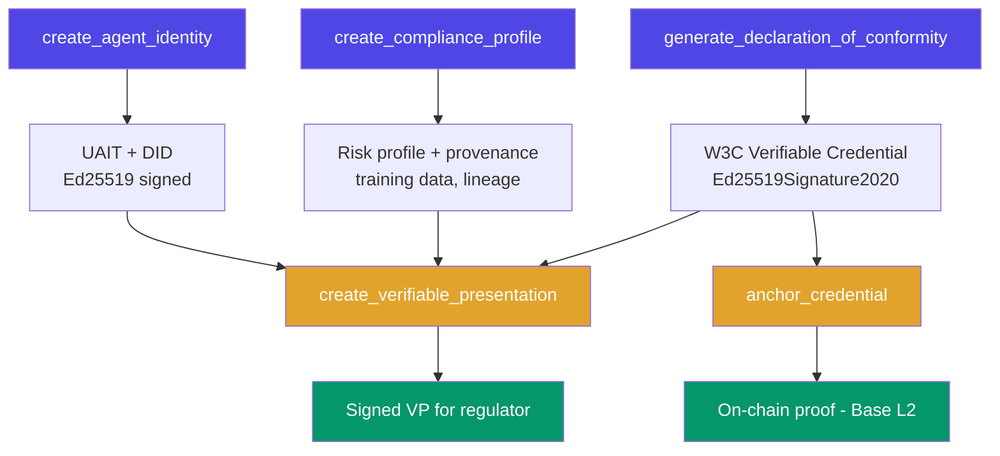

<div class="hero" markdown>

{ width="140" }

# Attestix

**Attestation Infrastructure for AI Agents**

Identity and signed evidence for AI governance workflows. Verifiable identity, W3C credentials, delegation chains, and reputation scoring for every AI agent.

[Get Started](getting-started.md){ .md-button .md-button--primary }
[API Reference](api-reference.md){ .md-button }

</div>

---

## Why Attestix Exists

Attestix combines agent identity, credential issuance, delegation, provenance and offline verification. Signed records can be exchanged and independently checked within the documented profile; they do not establish the truth or legal status of their contents.

The AI Act applies in stages. The current EU timeline includes 2 December 2027 for specified Annex III high-risk systems and 2 August 2028 for specified Annex I systems. Applicability depends on the operator's role and system. See the [European Commission timeline](https://digital-strategy.ec.europa.eu/en/policies/regulatory-framework-ai).

---

## MCP tools Across 9 Modules

| Module | Purpose |
|--------|---------|
| **Identity** | Unified Agent Identity Tokens (UAITs) bridging MCP OAuth, A2A, DIDs, and API keys. local data erasure tooling |
| **Agent Cards** | Parse, generate, and discover A2A-compatible agent cards |
| **DID** | Create and resolve W3C Decentralized Identifiers (`did:key`, `did:web`) |
| **Delegation** | UCAN-style capability delegation with signed JWT tokens, revocation |
| **Reputation** | Recency-weighted trust scoring with category breakdown |
| **Compliance** | EU AI Act risk profiles, conformity assessments, Annex V declarations |
| **Credentials** | W3C Verifiable Credentials with Ed25519Signature2020, external verification |
| **Provenance** | Training data provenance, model lineage, hash-chained audit trail |
| **Blockchain** | Anchor artifact hashes to Base L2 via EAS, Merkle batch anchoring |

---

## Quick Start

=== "MCP Server (Claude Code)"

    Add to your Claude Code config:

    ```json
    {
      "mcpServers": {
        "attestix": {
          "type": "stdio",
          "command": "python",
          "args": ["-m", "attestix.main"]
        }
      }
    }
    ```

    Then ask Claude:

    > "Create an identity for my data analysis agent"

=== "pip install"

    ```bash
    pip install attestix
    ```

=== "From Source"

    ```bash
    git clone https://github.com/VibeTensor/attestix.git
    cd attestix
    pip install -r requirements.txt
    python -m attestix.main
    ```

See the [Getting Started guide](getting-started.md) for full setup instructions.

---

## How It Works



---

## Key Properties

- **Local-first** - Local identity and credential operations can use JSON storage; remote resolution, hosted signers and blockchain integrations require their configured services
- **Cryptographically signed** - Credentials and presentations carry signatures; hash-chained records support integrity checks. Trust, freshness and completeness require separate policy
- **Standards-based** - W3C Verifiable Credentials, W3C DIDs, UCAN delegation, A2A agent cards
- **Vendor-neutral** - Works with any AI framework (LangChain, OpenAI Agents SDK, CrewAI, or plain Python)
- **AI governance evidence tooling** - Risk classification, conformity assessments, Annex V declarations, Article 10/11/12 documentation

---

## Research Paper

Attestix is described in a research paper that covers the architecture, cryptographic pipeline, and evaluation results.

**[Attestix: A Unified Attestation Infrastructure for Autonomous AI Agents](research.md)**

Pavan Kumar Dubasi, VibeTensor Private Limited, 2026.

```bibtex
@article{dubasi2026attestix,
  title     = {Attestix: A Unified Attestation Infrastructure for Autonomous AI Agents},
  author    = {Dubasi, Pavan Kumar},
  year      = {2026},
  url       = {https://github.com/VibeTensor/attestix},
  note      = {Open-source. Apache License 2.0}
}
```

See the [Research Paper](research.md) page for full citation formats (BibTeX, APA, IEEE) and evaluation highlights.

---

## Important Disclaimer

Attestix generates machine-readable, cryptographically signed compliance documentation for AI agents. It is a documentation and evidence tooling system.

**Attestix does not replace legal counsel, notified body assessments, or official regulatory submissions.** Always consult qualified legal professionals for compliance decisions.

---

## License

Apache License 2.0. See [LICENSE](https://github.com/VibeTensor/attestix/blob/main/LICENSE).

---

Built by [VibeTensor](https://vibetensor.com)
